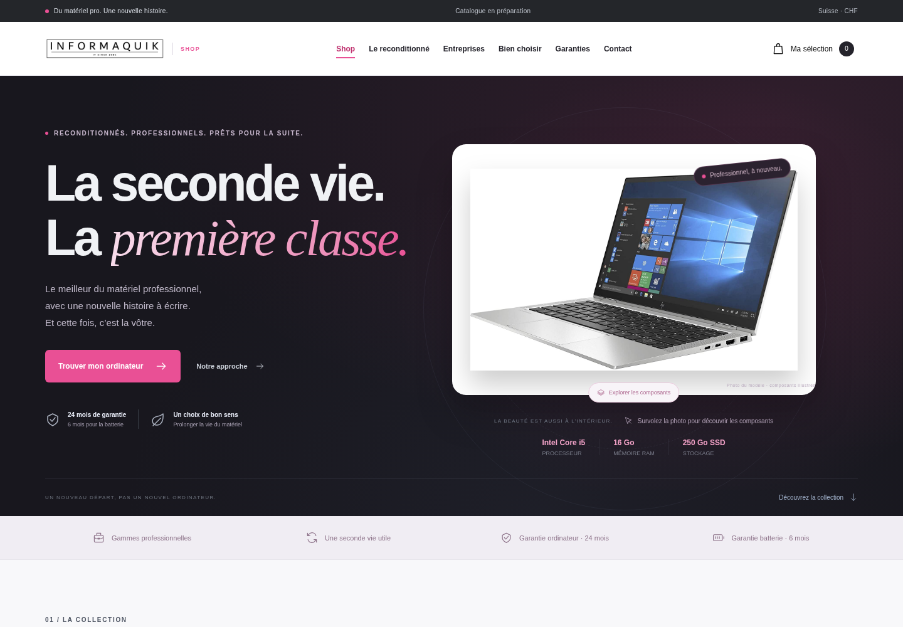

# Informaquik Shop

Boutique visuelle d’ordinateurs professionnels reconditionnés, en français, avec dix configurations transcrites des fiches fournies.



## Tester sans installation

Ouvrez **`downloads/Informaquik-Shop.html`** dans Edge, Chrome ou Firefox. Ce fichier contient toute la boutique et fonctionne sans serveur ni connexion Internet. L’archive **`downloads/Informaquik-Shop.zip`** contient la même version et ses instructions.

Depuis les sources, ouvrir `index.html` fonctionne également. Conservez `app.js`, `pages.js`, `photos.js`, `style.css`, `catalogue.js` et `assets/` à côté du fichier.

## Fonctions

- Identité inspirée de [i-q.ch](https://i-q.ch/) : logo officiel, blanc, gris, noir et rose ; composition éditoriale propre à la boutique.
- Photos de chaque famille de modèles, conservées localement ; galerie de deux vues pour les HP.
- Exploration pédagogique des composants au survol ou au bouton, utilisable au clavier et sur mobile.
- Cinq pages complémentaires : **Le reconditionné**, **Entreprises**, **Bien choisir**, **Garanties & SAV**, **Contact**.
- Guide interactif : recommandations selon l’usage, le budget et le besoin d’un écran tactile.
- Contact : coordonnées publiques vérifiées, formulaire qui prépare un e-mail dans la messagerie du visiteur, motif SAV ou entreprise prérempli depuis les pages correspondantes.
- Catalogue organisé par marque et modèle, recherche, filtres d’usage et tactile, tri par prix ou mémoire.
- Fiches détaillées : configuration, connectique, système, état et provenance à préciser.
- Prix de vente TTC en CHF ; TVA de 8,1 % selon les fiches fournies.
- Garantie ordinateur **24 mois**, garantie batterie **6 mois**, confirmées pour ce projet.
- Panier enregistré dans le navigateur, quantités, suppression, total et export de la sélection en HTML imprimable ou en PDF via le dialogue d’impression du navigateur.
- Présentation du réemploi de gammes professionnelles provenant, selon les lots, de parcs d’entreprises, administrations, services publics ou militaires.
- Mise en page adaptée aux ordinateurs et mobiles ; animations désactivables selon la préférence de mouvement réduit.

Les photos présentent les modèles, pas l’état d’un exemplaire précis. Le schéma des composants est générique et explicitement pédagogique. Les sources et crédits figurent dans [docs/SOURCES-VISUELS.md](docs/SOURCES-VISUELS.md). Les coûts d’achat et marges des captures ne sont pas inclus dans le catalogue ni la distribution.

## Le catalogue fourni

Dix références distinctes, après suppression des captures répétées :

| Modèle                         | Processeur                         | RAM   | SSD    | Prix TTC  |
| ------------------------------ | ---------------------------------- | ----- | ------ | --------- |
| HP EliteBook x360 1030 G7      | Core i5-10210U                     | 16 Go | 250 Go | 699 CHF   |
| Lenovo ThinkPad X13 Yoga Gen 2 | Core i7-1185G7                     | 16 Go | 256 Go | 799 CHF   |
| HP EliteBook 850 G7 · i7       | Core i7-10610U                     | 16 Go | 256 Go | 799 CHF   |
| HP EliteBook 850 G7 · i5       | Core i5-10210U                     | 16 Go | 512 Go | 799 CHF   |
| HP EliteBook 850 G8            | Core i5-1145G7                     | 32 Go | 256 Go | 799 CHF   |
| HP ZBook Studio G7             | Core i7-10850H                     | 32 Go | 512 Go | 1 499 CHF |
| HP EliteBook x360 1030 G8      | Core i7-1185G7                     | 16 Go | 512 Go | 799 CHF   |
| HP ProBook x360 435 G10        | AMD Ryzen 5, référence à confirmer | 16 Go | 256 Go | 799 CHF   |
| Lenovo ThinkPad T14 Gen 1      | Core i5-10310U                     | 16 Go | 256 Go | 599 CHF   |
| Lenovo ThinkPad T14s Gen 2     | Core i5-1145G7                     | 16 Go | 250 Go | 799 CHF   |

Les points à vérifier sont regroupés dans [CATALOGUE-A-VERIFIER.md](CATALOGUE-A-VERIFIER.md). Aucune quantité disponible, note d’état ou provenance de lot n’a été inventée.

## Adapter les informations

Modifier **`catalogue.js`** : identité, devise, garanties et coordonnées dans `SHOP_CONFIG` ; modèles, caractéristiques, prix et disponibilités dans `SHOP_PRODUCTS`.

`stock: null` signifie que la disponibilité doit être confirmée. Le panier permet de préparer une demande, sans réserver un stock. Renseigner une quantité réelle permet de limiter la sélection à cette quantité. Les filtres de marque se construisent automatiquement à partir du catalogue.

`contactEmail` contient l’adresse publique `info@i-q.ch`, relevée sur le site de référence. Le panier et le formulaire ouvrent un message à vérifier et à envoyer depuis la messagerie du visiteur. Aucun e-mail n’est envoyé automatiquement. Effacer cette valeur désactive le bouton e-mail du panier et propose le téléchargement du message de contact en texte. La version actuelle ne collecte pas de paiement, ne transmet pas de commandes et ne propose pas de gestion de stock partagée. Publier le dépôt ne met pas automatiquement la boutique en ligne.

Les photographies et leurs crédits sont configurés dans **`photos.js`**. Les deux configurations du 850 G7 partagent les visuels du même châssis. Le contenu des pages et leur navigation se trouvent dans **`pages.js`**.

## Développement et vérification

Aucune dépendance à installer ; Node.js 24 ou supérieur suffit pour les commandes de développement.

```sh
npm start
npm test
npm run package
```

Le serveur de développement utilise le port 4173 (`PORT` et `HOST` configurables). Il sert uniquement les ressources de la boutique. `npm run package` fabrique le fichier HTML autonome et le ZIP dans `downloads/` avec les sommes SHA-256.

La version autonome est vérifiée dans un navigateur, notamment l’ouverture sans serveur, le chargement des photos, les galeries, les cinq nouvelles pages, le guide, le formulaire, l’exploration des composants, les filtres, les fiches, le panier persistant, l’export et la mise en page mobile. Les tests Node vérifient la fidélité des données et l’exclusion des coûts internes.

## Configuration cloud

Le projet est séparé de `Gestion-des-horaires`. Utiliser directement le dossier `/workspace/Informaquik-Shop`, sans créer de worktree. Les fichiers persistent, mais le processus `npm start` doit être relancé dans une nouvelle tâche si le serveur est nécessaire.
